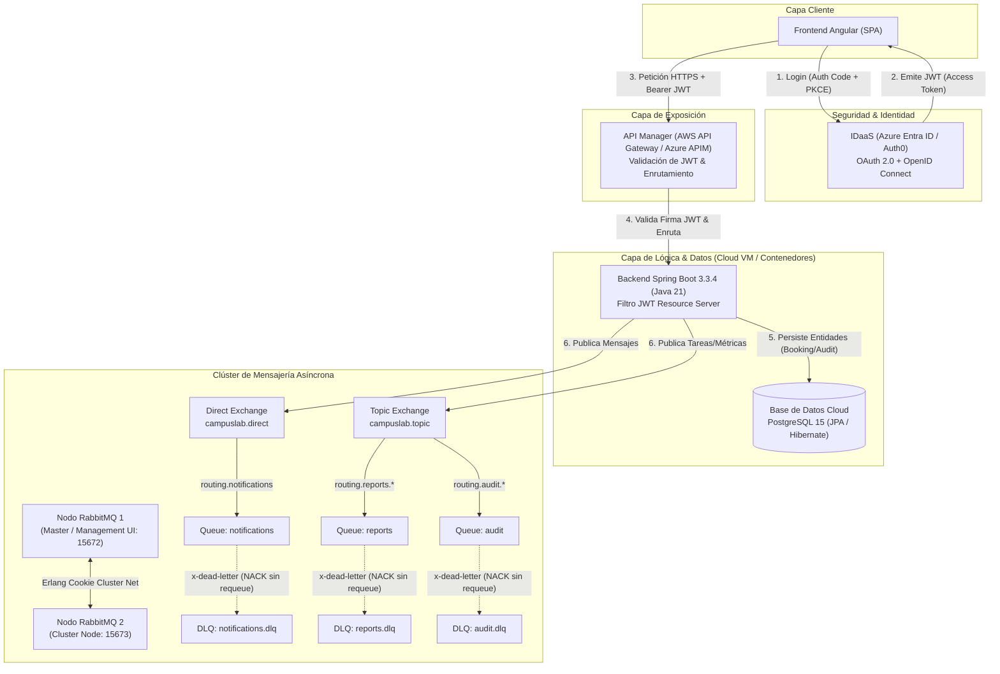

# Guía Maestra de Defensa y Demostración en Vivo - EP4 (Presentación 100%)
**Asignatura:** DSY1107 - Desarrollo Cloud Native I  
**Evaluación:** Evaluación Parcial N°4 (Presentación Oral y Demostración Práctica)  
**Duración Estimada:** 5 a 10 minutos  
**Estructura:** Discurso Técnico + Demostración Cloud Paso a Paso + Preguntas Frecuentes del Docente

---

## 1. Resumen Ejecutivo de la Arquitectura

---

## 2. Guion de la Presentación Oral (Minuto a Minuto: 7 - 8 Minutos)

### Minuto 0:00 - 1:00 | Introducción y Planteamiento del Problema
> *"Buenas tardes profesor y compañeros. Hoy presentamos la solución para la plataforma **CampusLab**, diseñada bajo los estándares de una arquitectura **Cloud Native** moderna, desacoplada y de alta disponibilidad.*  
> *El objetivo principal de esta entrega fue transformar un sistema previamente acoplado en un ecosistema reactivo y resiliente mediante mensajería asíncrona con **RabbitMQ en Clúster**, autenticación federada con **IDaaS**, seguridad perimetral mediante **API Manager**, y persistencia relacional en **PostgreSQL Cloud**."*

### Minuto 1:00 - 2:30 | Capa de Seguridad e Identidad (IDaaS + API Manager)
> *"Para el control de accesos implementamos el estándar de la industria: **OAuth 2.0 y OpenID Connect** utilizando un **IDaaS** (Azure Entra ID / Auth0).*  
> *(Mostrar consola del IDaaS): Aquí pueden observar el Tenant creado y los usuarios registrados con roles específicos.*  
> *En el Frontend Angular, el login redirige mediante el flujo **Authorization Code Flow con PKCE**, garantizando que las credenciales nunca viajen ni se almacenen en el navegador, obteniendo un **JSON Web Token (JWT)** firmado criptográficamente.*  
> *(Mostrar API Manager): Todas las peticiones del frontend pasan obligatoriamente por nuestro **API Gateway**. El API Manager cuenta con una política de validación de JWT que inspecciona la firma, emisor (`iss`) y expiración (`exp`). Si realizamos una petición sin token o con firma adulterada, el Gateway la rechaza inmediatamente con un `401 Unauthorized` sin saturar nuestros servicios internos; si el token es válido, lo reenvía al backend."*

### Minuto 2:30 - 4:00 | Infraestructura Cloud & Clúster RabbitMQ (Docker Compose)
> *(Mostrar terminal o consola de la nube donde corre `docker compose ps`):*  
> *"Nuestra infraestructura está orquestada mediante Docker Compose y desplegada en la nube. Contamos con:*  
> *1. **PostgreSQL 15 Cloud** para la persistencia transaccional.*  
> *2. **Clúster de RabbitMQ de 2 Nodos** (`rabbitmq1` y `rabbitmq2`). Ambos nodos comparten una cookie de Erlang común (`supersecretcookie`) y forman un clúster activo, lo que permite replicación y tolerancia a fallos.*  
> *(Abrir RabbitMQ Management Console en `http://<IP>:15672`):*  
> *En la pestaña 'Overview' pueden verificar que RabbitMQ reconoce ambos nodos en el clúster. En la pestaña 'Exchanges' observamos los exchanges configurados:*  
> *- `campuslab.direct`: Para enrutamiento punto a punto con routing keys exactas.*  
> *- `campuslab.topic`: Para enrutamiento basado en patrones jerárquicos (`routing.reports.#`, `routing.audit.#`).*  
> *Y en la pestaña 'Queues' observamos las 3 colas principales junto a sus 3 **Dead Letter Queues (DLQ)** asociadas."*

### Minuto 4:00 - 6:00 | Demostración en Vivo de Mensajería: ACK, NACK y DLQ
> *(Mostrar Frontend en acción):*  
> *1. **Prueba de Flujo Exitoso (ACK):** Al presionar 'Disparar Notificación', el frontend envía una petición autenticada al API Manager, el backend procesa el evento y publica en `campuslab.direct`. El consumidor `@RabbitListener` recibe el mensaje, ejecuta el procesamiento de negocio y envía una confirmación explícita con `channel.basicAck()`. En la consola de RabbitMQ vemos el mensaje entrar y salir de inmediato.*  
> *2. **Prueba de Persistencia en Base de Datos:** Al presionar 'Registrar Auditoría', el mensaje viaja por el exchange topic, el listener de auditoría lo consume y lo guarda automáticamente en PostgreSQL mediante nuestro repositorio JPA (`AuditLogRepository`). Al presionar 'Consultar Registros BD', vemos la confirmación directa de los datos almacenados en la base de datos.*  
> *3. **Prueba Crítica de Resiliencia (Fallo, NACK y DLQ):** ¿Qué ocurre si un mensaje viene corrupto o falla el procesamiento? Al presionar 'Activar Fallo y Enviar a DLQ', enviamos una carga con error. El consumidor detecta la excepción, captura el evento en el log y ejecuta `channel.basicNack(tag, false, requeue = false)`. Como la cola tiene configurados los argumentos `x-dead-letter-exchange` y `x-dead-letter-routing-key`, RabbitMQ no descarta el mensaje, sino que lo transfiere automáticamente a `campuslab.booking.notifications.dlq`.*  
> *(Ir de inmediato a RabbitMQ Management Console y abrir la cola DLQ):*  
> *Aquí pueden comprobar que la cola normal quedó limpia y el mensaje fallido está en la DLQ disponible para auditoría o reintento."*

### Minuto 6:00 - 7:30 | Microservicio Administrador de RabbitMQ
> *(Mostrar la sección 02 del Dashboard / Postman):*  
> *"Cumpliendo con la rúbrica, implementamos un microservicio administrador que desacopla la gestión de la infraestructura mediante una API REST:*  
> *- Permite declarar dinámicamente colas (`POST /api/admin/queues`), exchanges (`POST /api/admin/exchanges`) y bindings.*  
> *- Cuenta con validación estricta de DTOs (`@NotBlank`, regex de nomenclatura válida), impidiendo nombres vacíos o configuraciones corruptas.*  
> *- Toda la lógica interactúa mediante una clase de servicio especializada (`RabbitAdminService`), aislando por completo al controlador de las librerías AMQP.*  
> *(Crear una cola de prueba en vivo desde la UI y mostrarla apareciendo instantáneamente en RabbitMQ Management Console)."*

### Minuto 7:30 - 8:30 | Conclusión y Justificación Técnica
> *"En conclusión, hemos implementado una solución Cloud Native que cumple al 100% las rúbricas de EP3 y EP4:*  
> *- Desacoplamiento total entre productores y consumidores.*  
> *- Resiliencia ante fallos con ACK manual y colas Dead Letter.*  
> *- Doble validación de seguridad (API Gateway perimetral + Resource Server en Backend).*  
> *- Persistencia relacional normalizada.*  
> *Quedamos a su disposición para cualquier pregunta. Muchas gracias."*

---

## 3. Matriz de Preguntas Frecuentes del Docente (Cómo Responder)

| Pregunta Típica del Profesor | Respuesta Técnica Precisa |
|---|---|
| **¿Por qué configuraron el modo de ACK en MANUAL y no AUTOMÁTICO?** | *"Si usamos ACK automático (`NONE`), RabbitMQ marca el mensaje como entregado tan pronto lo despacha por la red. Si el servidor se apaga o ocurre una excepción en mitad del procesamiento, el mensaje se pierde irrevocablemente. Con ACK `MANUAL`, garantizamos que el mensaje solo se confirma cuando la lógica de negocio finaliza con éxito. Si falla, emitimos un `basicNack` con `requeue=false` para derivarlo a la DLQ sin perder datos."* |
| **¿Cómo sabe la cola normal hacia qué DLQ debe enviar el mensaje fallido?** | *"Al momento de declarar la cola en `RabbitMQConfig`, inyectamos los argumentos `x-dead-letter-exchange` (apuntando a `campuslab.direct`) y `x-dead-letter-routing-key` (con el nombre de la DLQ). RabbitMQ lee estos metadatos cuando el consumidor hace NACK con requeue falso."* |
| **¿Cuál es la diferencia de diseño entre el exchange `campuslab.direct` y `campuslab.topic`?** | *"El Direct Exchange se utiliza para tareas unívocas con enrutamiento exacto 1 a 1 (ej: notificaciones de booking). El Topic Exchange permite enrutamiento por patrones (`wildcards` como `*` y `#`), lo que permite que múltiples consumidores se suscriban a categorías jerárquicas como eventos de auditoría (`routing.audit.#`) o reportes sin modificar el productor."* |
| **¿Por qué validar el JWT en el API Manager y además en el Backend?** | *"Es el principio de **Defensa en Profundidad (Zero Trust)**. El API Manager actúa como primer cortafuegos perimetral, evitando que tráfico no autorizado consuma cómputo interno. El Backend mantiene su propio filtro Resource Server para protegerse ante llamadas internas o en caso de una mala configuración del gateway."* |
| **¿Cómo se asegura la alta disponibilidad en RabbitMQ?** | *"Mediante el clúster de 2 nodos configurado con Docker Compose. Los nodos comparten la misma Erlang cookie y sincronizan el esquema de exchanges, colas y bindings. Si un nodo se cae, el servicio continúa operativo en el segundo nodo."* |

---

- [x] Docker Compose levantado con `restart: unless-stopped`: `rabbitmq1`, `rabbitmq2`, `campuslab_frontend`.
- [x] RabbitMQ Management UI disponible en `http://52.200.87.76:15672` (Usuario: `admin` / Contraseña: `admin`).
- [x] PostgreSQL Cloud activo en puerto 5432 con base de datos `campuslab` (tablas `bookings` y `audit_logs`).
- [x] Backend Spring Boot 3.3.4 (Java 21) activo en EC2 (`http://52.200.87.76:8080/api/health` -> `{"status":"UP"}`).
- [x] AWS API Gateway activo con JWT Authorizer (`https://hygoaj1glh.execute-api.us-east-1.amazonaws.com`).
- [x] Caddy con SSL automático Let's Encrypt para `https://52-200-87-76.sslip.io`.
- [x] Microsoft Entra ID (IDaaS) con usuario evaluador:
  - **Tenant:** `CampusLabFinal.onmicrosoft.com` (`4b9ee4c5-a799-40af-88fe-81d4ef8aaba3`)
  - **App Registration:** `CampusLab-Real-App` (`618a6485-6e73-4faf-803c-8e120dd362f4`)
  - **Usuario Evaluador:** `estudiante@CampusLabFinal.onmicrosoft.com`
  - **Contraseña:** `CampusLab2026!`
- [x] Pestañas del navegador listas para la demo en vivo:
  1. Frontend CampusLab Cloud: `https://52-200-87-76.sslip.io`
  2. RabbitMQ Management Console: `http://52.200.87.76:15672/#/queues` (`admin`/`admin`)
  3. Consola Microsoft Entra ID (IDaaS): `https://portal.azure.com` -> Tenant `CampusLabFinal` -> Usuarios y Aplicaciones.
  4. Consola AWS API Gateway: `https://us-east-1.console.aws.amazon.com/apigateway/` -> API `hygoaj1glh`.
