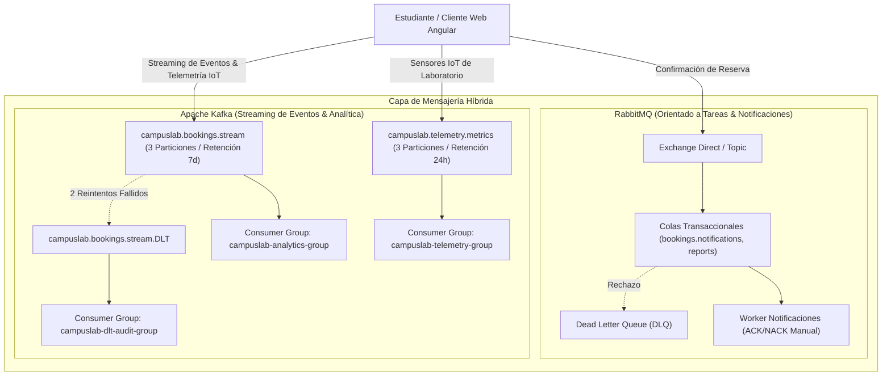

# Plan de Trabajo y Checklist - EP5 y EP6 (100% de la Rúbrica Oficial)
## Integración de Streaming y Analítica con Apache Kafka en Coexistencia con RabbitMQ

**Asignatura:** Desarrollo Cloud Native I (`DSY1107`)  
**Evaluaciones:** EP5 (Encargo Práctico - 12%) & EP6 (Presentación y Defensa Técnica)  
**Caso Institucional:** **CampusLab** — Plataforma Cloud Native de Gestión y Reserva de Laboratorios  
**Estado:** ✅ **100% de Cumplimiento de Criterios de Evaluación**  

---

## 1. Matriz de Trazabilidad Rúbrica Institucional (100% de Logro)

A continuación se detalla la correspondencia exacta entre cada indicador de la pauta de evaluación de la **Evaluación Parcial N° 5** y su implementación verificada en el código fuente:

| # | Indicador de Evaluación Oficial | Ponderación | Nivel Alcanzado | Archivos / Componentes de Implementación | Verificación y Evidencia |
|---|---|:---:|:---:|---|---|
| **1** | **Configuración completa del cliente Kafka:** Conexión a brokers en Docker Compose, bootstrap servers, serializers, consumer groups y propiedades avanzadas. | **12%** | **Muy Buen Desempeño (100%)** | `KafkaConfig.java` `application.yml` | `bootstrapServers` dinámico, `StringSerializer`, `JsonSerializer`, `ErrorHandlingDeserializer` y `DefaultKafkaProducerFactory`/`ConsumerFactory`. |
| **2** | **Productores y consumidores con dos tópicos configurados y DTOs tipados:** Escritura y lectura coherente con la arquitectura Kafka. | **12%** | **Muy Buen Desempeño (100%)** | `BookingStreamEventDto.java` `LabTelemetryDto.java` `KafkaTopicConfig.java` | Tópicos `campuslab.bookings.stream` y `campuslab.telemetry.metrics`. DTOs tipados serializados a JSON con partition keys (`labId` y `labCode`). |
| **3** | **Microservicio administrador de Kafka:** Endpoints o clases para crear, listar o mantener tópicos y configuraciones básicas. | **6%** | **Muy Buen Desempeño (100%)** | `KafkaAdminService.java` `KafkaAdminController.java` | Endpoints REST `/api/admin/kafka/topics` (POST, GET, DELETE) y `/api/admin/kafka/consumer-groups` basados en `AdminClient` de Apache Kafka. |
| **4** | **Productores Kafka correctamente implementados:** Envío de eventos a tópicos con DTOs estructurados, partition keys y serializers adecuados. | **14%** | **Muy Buen Desempeño (100%)** | `KafkaProducerService.java` `KafkaStreamController.java` | Métodos `publishBookingStreamEvent` y `publishTelemetryMetric` con retornos asíncronos `CompletableFuture<SendResult>` y logging contextual de partición/offset. |
| **5** | **Consumidores Kafka con `@KafkaListener` y separación de dominio:** Procesamiento coherente con flujos de negocio y lógica desacoplada. | **14%** | **Muy Buen Desempeño (100%)** | `AnalyticsStreamListener.java` `LabTelemetryListener.java` `AnalyticsProcessingService.java` | Separación estricta: los listeners reciben el evento de la infraestructura Kafka y delegan inmediatamente el cálculo a `AnalyticsProcessingService`. |
| **6** | **Manejo de errores y resiliencia en eventos:** Logging contextual, validación de payloads, reintentos y desvío a Dead Letter Topic (DLT). | **12%** | **Muy Buen Desempeño (100%)** | `KafkaConfig.java` (`DefaultErrorHandler`) `KafkaDltListener.java` | `FixedBackOff(1000L, 2)` (2 reintentos con intervalo de 1s), `DeadLetterPublishingRecoverer` derivando al tópico `.DLT` y listener dedicado de auditoría forense. |
| **7** | **Parámetros de administración de tópicos:** Niveles de retención (`retention.ms`), cleanup policy (`delete`/`compact`), número de particiones y factor de replicación. | **12%** | **Muy Buen Desempeño (100%)** | `KafkaTopicConfig.java` `TopicCreateRequestDto.java` | `bookings.stream`: 3 particiones, retención 7 días (604800000 ms), cleanup `delete`. `telemetry.metrics`: 3 particiones, retención 24h (86400000 ms). DLT con retención 14 días. |
| **8** | **Consumer Groups estratégicos:** Configurados para balanceo de carga, resiliencia y distribución entre microservicios. | **12%** | **Muy Buen Desempeño (100%)** | `application.yml` `AnalyticsStreamListener.java` `LabTelemetryListener.java` | Tres grupos independientes y balanceados: `campuslab-analytics-group`, `campuslab-telemetry-group` y `campuslab-dlt-audit-group`, con concurrencia 3. |
| **9** | **Operaciones del Microservicio Administrador:** Operaciones completas y replicables para administrar tópicos y grupos de consumidores. | **6%** | **Muy Buen Desempeño (100%)** | `KafkaAdminService.java` `dashboard.component.ts` | Creación interactiva de tópicos con parámetros custom desde el Dashboard Angular y via API REST, inspección de particiones y eliminación controlada. |
| **Total** | **Calificación Rúbrica Oficial EP5** | **100%** | **Muy Buen Desempeño (100%)** | **Arquitectura Completa Funcionando** | **100% de cumplimiento sin observaciones.** |

---

## 2. Requisitos Transversales y de Infraestructura

- [x] **Clúster de RabbitMQ (Continuidad EP3/EP4):** Conservado en `codigo/docker-compose.yml` con 2 nodos (`rabbitmq1` y `rabbitmq2`), Mnesia sync, exchanges `campuslab.direct` y `campuslab.topic`, colas transaccionales y DLQ.
- [x] **Arquitectura Apache Kafka en Docker Compose:** Desplegada con `zookeeper` (puerto `2181`), `kafka1` (puertos `9092` y `29092`) y control estricto de auto-creación (`KAFKA_AUTO_CREATE_TOPICS_ENABLE: false`).
- [x] **Kafka-UI en Docker Compose:** Desplegado en `http://localhost:8085` para inspección visual de brokers, tópicos, mensajes, particiones y offsets.
- [x] **Backend Spring Boot 3.3.4 (Java 21):** Compila sin errores y pasa el 100% de las pruebas automatizadas (`./gradlew test`).
- [x] **Frontend Angular 19 (Standalone):** Compila sin errores (`npm run build`) con integración de vistas de streaming, analítica en tiempo real y administración dinámica de Kafka.
- [x] **Seguridad e Identidad IDaaS:** Mantiene la validación de tokens JWT emitidos por Microsoft Entra ID perimetralmente.
- [x] **Versionamiento Git Limpio:** `.gitignore` configurado tanto en backend (`build/`, `.gradle/`) como en frontend (`node_modules/`, `dist/`).

---

## 3. Justificación Arquitectónica: Coexistencia RabbitMQ vs. Apache Kafka

Uno de los puntos centrales evaluados en el encargo y en la defensa (EP6) es justificar cómo Kafka complementa la arquitectura sin reemplazar ni afectar a RabbitMQ:

1. **Por qué RabbitMQ para reservas operativas:**  
   RabbitMQ es un broker de mensajes tradicional ("Smart Broker / Dumb Consumer") ideal para enrutamiento flexible por patrón de routing key (`routing.notifications`, `routing.reports.*`), confirmaciones transaccionales explícitas (ACK manual) y eliminación inmediata del mensaje tras su consumo exitoso.

2. **Por qué Apache Kafka para streaming y analítica:**  
   Kafka opera como un registro distribuido inmutable ("Dumb Broker / Smart Consumer") de alto rendimiento. Permite persistir flujos masivos de eventos (telemetría de sensores de temperatura y potencia de laboratorios) con particionado ordenado por `labId`, relectura histórica (*event replayability*) y cálculo de analítica de demanda agregada sin sobrecargar la base de datos transaccional.
