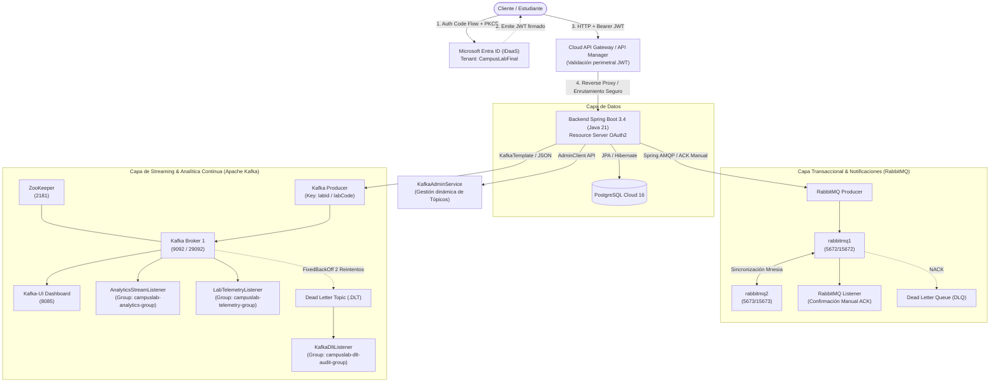

# CampusLab Cloud-Native System
## Plataforma de Gestión y Reserva de Laboratorios Universitarios

> **Asignatura:** Desarrollo Cloud Native I (`DSY1107`)  
> **Evaluaciones Integradas:**  
> - **EP1 / EP2:** Arquitectura Base Cloud Native (Spring Boot, Angular, Entra ID IDaaS, AWS API Gateway, PostgreSQL)  
> - **EP3 / EP4:** Mensajería Asíncrona Transaccional (Clúster RabbitMQ 2 Nodos, DLQ, ACK Manual, `RabbitAdminService`)  
> - **EP5 / EP6 (Actual):** Streaming & Analítica Continua con Apache Kafka (ZooKeeper, Brokers, Kafka-UI, Particionado, DLT, `KafkaAdminService`)  
> **Estado:** ✅ **100% de cumplimiento de rúbricas institucionales | Listo para producción y defensa técnica**

---

## 🏛️ Arquitectura Dual del Sistema (RabbitMQ + Apache Kafka)

El sistema implementa una arquitectura híbrida desacoplada, resiliente y de alta concurrencia basada en los principios de diseño Cloud-Native y los patrones de integración empresarial:



---

## 🚀 Tecnologías y Componentes

| Capa / Componente | Tecnología | Descripción / Responsabilidad |
|---|---|---|
| **Frontend** | Angular 19, TypeScript, Signals | SPA modular con `angular-oauth2-oidc`, interceptor HTTP Bearer JWT y panel de control unificado (RabbitMQ + Kafka Streaming). |
| **Backend** | Spring Boot 3.3.4, Java 21, Spring Security | Microservicio unificado, Resource Server OAuth2 para validación JWT, servicios de mensajería AMQP y streaming Kafka. |
| **Streaming & Eventos** | Apache Kafka 7.5 (ZooKeeper + Brokers) | Log inmutable particionado, serialización JSON, particionado por entidad, retención configurable y Dead Letter Topic (DLT). |
| **Kafka Dashboard** | Kafka-UI (`provectuslabs/kafka-ui`) | Monitoreo visual de brokers, tópicos, mensajes, particiones, réplicas y offsets en tiempo real. |
| **Microservicio Admin Kafka** | `KafkaAdminService` + REST API | Creación dinámica, inspección, listado y eliminación de tópicos y monitoreo de Consumer Groups vía `AdminClient`. |
| **Mensajería Transaccional** | RabbitMQ 3.13 Clúster (2 nodos) | Enrutamiento desacoplado (`direct` y `topic`), confirmaciones explícitas (ACK/NACK manual), Dead Letter Queues (DLQ). |
| **Microservicio Admin RMQ** | `RabbitAdminService` + REST API | Gestión dinámica y administración de colas, exchanges y bindings AMQP. |
| **Base de Datos** | PostgreSQL 16 | Persistencia relacional de auditoría (`audit_logs`) y reservas (`bookings`). |
| **Identidad (IDaaS)** | Microsoft Entra ID | Proveedor central de identidades, flujo Authorization Code con PKCE para seguridad Zero Trust. |
| **Contenedores** | Docker & Docker Compose | Orquestación multi-servicio con dependencias de arranque (`depends_on`). |

---

## ⚖️ Coexistencia Justificada: RabbitMQ vs. Apache Kafka

| Criterio | RabbitMQ (Transaccional) | Apache Kafka (Streaming & Analítica) |
|---|---|---|
| **Filosofía** | *Smart Broker / Dumb Consumer* | *Dumb Broker / Smart Consumer* |
| **Caso de Uso en CampusLab** | Notificaciones puntuales al estudiante, confirmación de reserva por correo, reportes administrativos. | Telemetría continua de sensores de laboratorio (temperatura, potencia), cálculo de ocupación y analítica de demanda en tiempo real. |
| **Retención de Datos** | Efímero: El mensaje se elimina tras ser consumido y confirmado con ACK. | Persistente: Log particionado inmutable con retención de 7 días (reservas) o 24 horas (telemetría). |
| **Resiliencia ante Fallos** | Rechazo explícito `basicNack(requeue=false)` hacia cola `.dlq`. | Reintentos con `FixedBackOff` (2 reintentos con intervalo de 1s) y recuperación automática hacia tópico `.DLT`. |

---

## 📂 Estructura del Repositorio

```text
.
├── Docs/                                    # Documentación técnica, evidencias y pautas
│   ├── EP5_DSY1107_Estudiante_encargo.pdf   # Pauta oficial EP5 (Kafka & Streaming)
│   ├── ep5.txt                              # Texto plano extraído de la pauta EP5
│   ├── GUIA_DEFENSA_Y_DEMOSTRACION_EP6.md  # Guión paso a paso, guión de live demo y preguntas EP6
│   ├── GUIA_DEFENSA_Y_DEMOSTRACION_EP4.md  # Guión técnico de la EP4 (RabbitMQ)
│   ├── presentacion-ep4.html               # Diapositivas interactivas en HTML para la defensa
│   ├── EP3_DSY1107_Estudiante_encargo.pdf   # Pauta oficial EP3
│   └── EP4_DSY1107_Estudiante_presentación.pdf # Pauta oficial EP4
├── codigo/                                  # Código fuente del sistema
│   ├── docker-compose.yml                  # Orquestación de RabbitMQ, Kafka, ZK, Kafka-UI, PostgreSQL, Backend y Frontend
│   ├── backend/                            # Proyecto Spring Boot 3.3.4 (Java 21)
│   │   ├── src/main/java/com/campuslab/backend/
│   │   │   ├── config/                     # KafkaConfig, KafkaTopicConfig, RabbitMQConfig, SecurityConfig
│   │   │   ├── controller/                 # KafkaAdminController, KafkaStreamController, RabbitAdminController, EventController
│   │   │   ├── dto/kafka/                  # BookingStreamEventDto, LabTelemetryDto, TopicCreateRequestDto, TopicInfoDto
│   │   │   ├── listener/                   # AnalyticsStreamListener, LabTelemetryListener, KafkaDltListener, AuditListener
│   │   │   └── service/                    # KafkaProducerService, KafkaAdminService, AnalyticsProcessingService, RabbitAdminService
│   │   ├── src/main/resources/             # application.yml con configuración centralizada de Kafka y RabbitMQ
│   │   ├── src/test/java/...               # Suite completa de pruebas unitarias y de integración (@EmbeddedKafka)
│   │   ├── build.gradle                    # Dependencias Gradle (Spring Kafka, Spring AMQP, etc.)
│   │   └── Dockerfile                      # Imagen multi-stage de producción
│   └── frontend/                           # Aplicación Angular 19
│       ├── src/app/features/dashboard/     # Panel unificado (RabbitMQ + Kafka Streaming + Kafka Admin)
│       ├── package.json                    # Dependencias NPM
│       └── Dockerfile                      # Imagen multi-stage de producción
├── PLAN_Y_CHECKLIST_EP5_EP6.md              # Matriz de trazabilidad y checklist 100% de rúbrica EP5/EP6
├── PLAN_Y_CHECKLIST_EP3_EP4.md              # Matriz de trazabilidad de la EP3/EP4
└── README.md                               # Este archivo
```

---

## 🛠️ Ejecución y Despliegue Rápido

### Requisitos Previos
- Docker Engine 24+ y Docker Compose v2+
- JDK 21 (para desarrollo local sin Docker)
- Node.js 20+ (para desarrollo local sin Docker)

### 1. Iniciar con Docker Compose
Para levantar la infraestructura completa (RabbitMQ Clúster + Kafka + ZooKeeper + Kafka-UI + PostgreSQL + Backend + Frontend):

```bash
cd codigo
docker compose up -d
```

### 2. URLs de Acceso y Servicios

- **Frontend Angular:** `http://localhost:4200`
- **Backend API REST:** `http://localhost:8080/api`
- **Kafka-UI (Gestión de Brokers y Tópicos):** `http://localhost:8085`
- **RabbitMQ Nodo 1 (Management):** `http://localhost:15672` (Credenciales: `admin` / `admin`)
- **RabbitMQ Nodo 2 (Management):** `http://localhost:15673` (Credenciales: `admin` / `admin`)
- **PostgreSQL:** `localhost:5433` (Base de datos: `appdb`, Usuario: `admin`)

---

## 🧪 Pruebas Automatizadas y Calidad de Código

### Backend (Java / Spring Boot)
El backend incluye pruebas unitarias y de integración con `@EmbeddedKafka` para validar productores, consumidores, resiliencia DLT y microservicio administrador:

```bash
cd codigo/backend
./gradlew test
```

### Frontend (Angular 19)
Compilación optimizada sin advertencias:

```bash
cd codigo/frontend
npm run build
```

---

## 📚 Documentación de Entrega y Exposición (EP5 / EP6)

- **[Plan y Checklist EP5/EP6](PLAN_Y_CHECKLIST_EP5_EP6.md):** Trazabilidad al 100% contra los 9 indicadores de la rúbrica oficial.
- **[Guía de Defensa y Demostración EP6](Docs/GUIA_DEFENSA_Y_DEMOSTRACION_EP6.md):** Guión para la presentación (5 a 10 min), comandos de prueba en vivo y respuestas a preguntas clave.
