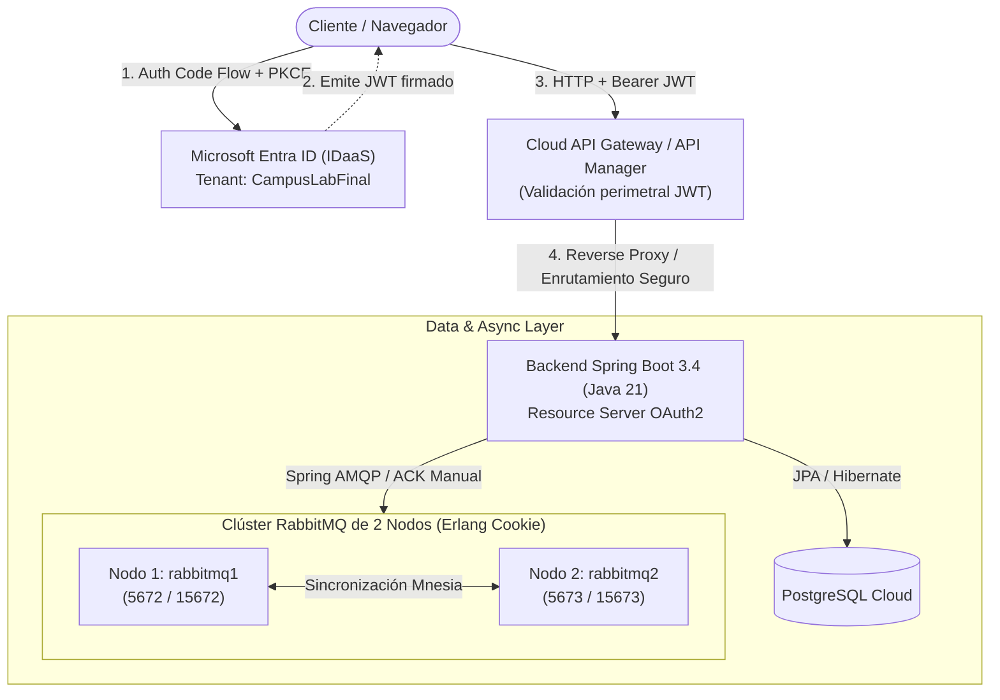

# CampusLab Cloud-Native System

> **Asignatura:** Desarrollo Cloud Native I (DSY1107)  
> **Evaluaciones:** EP3 (Encargo Práctico) & EP4 (Presentación y Defensa Técnica)  
> **Estado:** 100% de cumplimiento de rúbricas | Listo para producción y demostración

---

## 🏛️ Arquitectura del Sistema

El sistema implementa una arquitectura desacoplada, resiliente y de alta concurrencia basada en los principios de diseño Cloud-Native y los patrones de integración empresarial:



---

## 🚀 Tecnologías y Componentes

| Capa / Componente | Tecnología | Descripción / Responsabilidad |
|---|---|---|
| **Frontend** | Angular 19, TypeScript, Tailwind CSS | SPA modular con `angular-oauth2-oidc`, interceptor HTTP para Bearer JWT y panel de administración en tiempo real. |
| **Backend** | Spring Boot 3.4.3, Java 21, Spring Security | Microservicios REST, Resource Server OAuth2 para validación JWT, servicios de mensajería asíncrona. |
| **Mensajería** | RabbitMQ 3.13 Clúster (2 nodos) | Enrutamiento desacoplado (`direct` y `topic`), confirmaciones explícitas (ACK/NACK manual), Dead Letter Queues (DLQ). |
| **Microservicio Admin** | `RabbitAdminService` + REST API | Gestión dinámica y administración de colas, exchanges y bindings con validación rigurosa de DTOs. |
| **Base de Datos** | PostgreSQL 16 | Persistencia relacional de auditoría (`audit_logs`) y reservas (`bookings`). |
| **Identidad (IDaaS)** | Microsoft Entra ID | Proveedor central de identidades, flujo Authorization Code con PKCE para máxima seguridad Zero Trust. |
| **Contenedores** | Docker & Docker Compose | Orquestación multi-servicio con dependencias de arranque (`depends_on` con healthchecks). |

---

## 📂 Estructura del Repositorio

Siguiendo el estándar y separación estricta de responsabilidades:

```text
.
├── Docs/                                    # Documentación técnica y evidencias EP3/EP4
│   ├── GUIA_DEFENSA_Y_DEMOSTRACION_EP4.md  # Guión paso a paso, arquitectura y preguntas difíciles
│   ├── presentacion-ep4.html               # Diapositivas interactivas en HTML para la defensa
│   ├── EP3_DSY1107_Estudiante_encargo.pdf   # Pauta oficial EP3
│   ├── EP4_DSY1107_Estudiante_presentación.pdf # Pauta oficial EP4
│   └── screenshots...                      # Capturas de verificación y auditoría en la nube
├── codigo/                                  # Código fuente del sistema
│   ├── docker-compose.yml                  # Orquestación de RabbitMQ Clúster, PostgreSQL, Backend y Frontend
│   ├── backend/                            # Proyecto Spring Boot 3.4.3 (Java 21)
│   │   ├── src/main/java/...               # Controladores, Servicios, Listeners, Entidades
│   │   ├── src/main/resources/             # application.yml con configuración centralizada de RabbitMQ
│   │   ├── src/test/java/...               # Suite completa de pruebas unitarias y de integración
│   │   ├── build.gradle                    # Configuración de dependencias Gradle
│   │   └── Dockerfile                      # Imagen multi-stage de producción
│   └── frontend/                           # Aplicación Angular 19
│       ├── src/app/                        # Componentes standalone, servicios de autenticación e interceptores
│       ├── package.json                    # Dependencias NPM
│       ├── nginx.conf                      # Configuración de servidor web Nginx para Angular
│       └── Dockerfile                      # Imagen multi-stage de producción
├── PLAN_Y_CHECKLIST_EP3_EP4.md              # Matriz de trazabilidad y checklist 100% de rúbrica
└── README.md                               # Este archivo
```

---

## 🛠️ Ejecución y Despliegue Rápido

### Requisitos Previos
- Docker Engine 24+ y Docker Compose v2+
- JDK 21 (opcional, para desarrollo local sin Docker)
- Node.js 20+ (opcional, para desarrollo local sin Docker)

### 1. Iniciar con Docker Compose
Para levantar la infraestructura completa (PostgreSQL + Clúster RabbitMQ de 2 nodos + Backend + Frontend):

```bash
cd codigo
docker compose up -d --build
```

### 2. URLs de Acceso y Servicios

- **Frontend Angular:** `http://localhost:4200`
- **Backend API REST:** `http://localhost:8080/api`
- **RabbitMQ Nodo 1 (Management):** `http://localhost:15672` (Credenciales: `admin` / `admin`)
- **RabbitMQ Nodo 2 (Management):** `http://localhost:15673` (Credenciales: `admin` / `admin`)
- **PostgreSQL:** `localhost:5432` (Base de datos: `campuslab`, Usuario: `campuslab_user`)

---

## 🧪 Pruebas Automatizadas y Calidad de Código

### Backend (Java / Spring Boot)
El backend cuenta con pruebas unitarias para controladores, servicios de administración de RabbitMQ y pruebas de integración para persistencia:

```bash
cd codigo/backend
./gradlew test
```

### Frontend (Angular 19)
Compilación optimizada sin advertencias:

```bash
cd codigo/frontend
npm run build
```

---

## 📊 Mensajería Asíncrona (RabbitMQ): Topología y Confiabilidad

### Topología de Mensajería Implementada

1. **Exchange Directo (`campuslab.direct.exchange`):**
   - Routing Key: `booking.notification`
   - Cola Principal: `campuslab.booking.notifications`
   - Cola de Descarte: `campuslab.booking.notifications.dlq`
2. **Exchange de Tópicos (`campuslab.topic.exchange`):**
   - Routing Key Pattern: `report.*` -> Cola: `campuslab.reports.generation` (DLQ: `.dlq`)
   - Routing Key Pattern: `audit.#` -> Cola: `campuslab.audit.events` (DLQ: `.dlq`)

### Patrón Dead Letter Queue (DLQ) y ACK Manual
- **Confirmación Explícita (ACK):** En procesamiento exitoso, el listener invoca `channel.basicAck(deliveryTag, false)`.
- **Manejo de Excepciones (NACK + DLQ):** Ante fallo irrecuperable o payload corrupto, se ejecuta `channel.basicNack(deliveryTag, false, false)`, enviando el mensaje a su respectiva Dead Letter Queue sin pérdida de datos ni bloqueo de la cola principal.

---

## 📚 Documentación de Entrega y Exposición (EP4)

- **[Guía de Defensa y Demostración EP4](Docs/GUIA_DEFENSA_Y_DEMOSTRACION_EP4.md):** Guión técnico estructurado (5 a 10 min), respuestas a preguntas complejas de rúbrica, configuración cloud y comandos de demostración.
- **[Presentación Interactiva EP4](Docs/presentacion-ep4.html):** Diapositivas web interactivas con diagramas de alta definición, métricas del clúster y modo presentación.
- **[Plan y Checklist EP3/EP4](PLAN_Y_CHECKLIST_EP3_EP4.md):** Verificación punto por punto contra las rúbricas institucionales.
